<picture>
  <source media="(max-width: 600px)" srcset="assets/shinonome-bbs-mobile.svg" />
  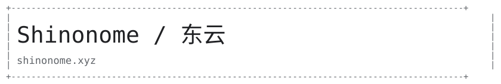
</picture>

[`[HOME]`](https://shinonome.xyz/) · [`[EXHIBITION]`](https://portfolio.shinonome.xyz/) · [`[BBS]`](https://bbs.shinonome.xyz/) · [`[MAIL]`](mailto:jzhou2409324124@gmail.com)

<picture>
  <source media="(max-width: 600px)" srcset="assets/section-projects-mobile.svg" />
  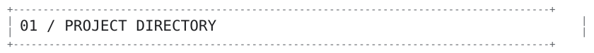
</picture>

<a href="https://shinonome.xyz/tu22/">
<picture>
  <source media="(max-width: 600px)" srcset="assets/project-tu22-mobile.svg" />
  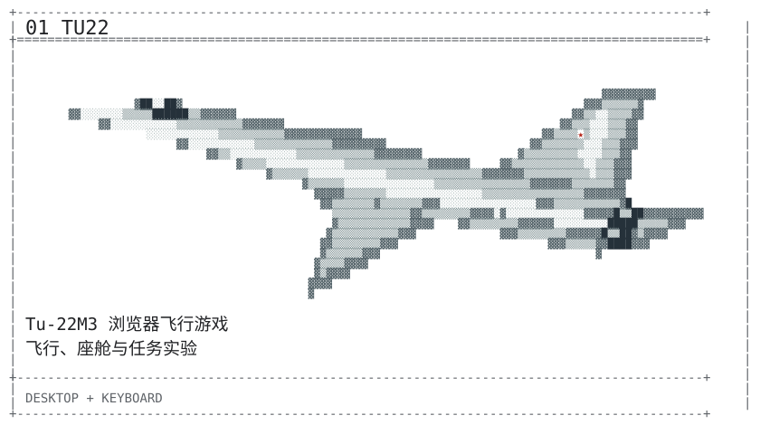
</picture>
</a>

[`[01 PLAY]`](https://shinonome.xyz/tu22/)

<a href="https://shinonome.xyz/cat-psych">
<picture>
  <source media="(max-width: 600px)" srcset="assets/project-cat-mobile.svg" />
  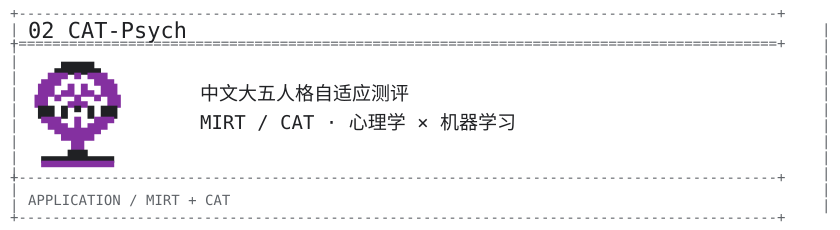
</picture>
</a>

[`[02 TRY]`](https://shinonome.xyz/cat-psych) · [`[SOURCE]`](https://github.com/2409324124/adaptive_psych_system)

<a href="https://preploop.shinonome.xyz/">
<picture>
  <source media="(max-width: 600px)" srcset="assets/project-prep-mobile.svg" />
  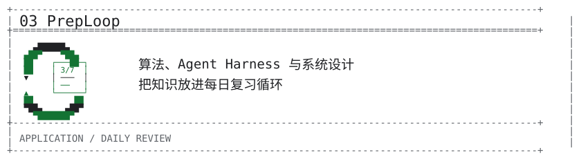
</picture>
</a>

[`[03 OPEN]`](https://preploop.shinonome.xyz/)

<a href="https://2409324124.github.io/xeon-max-9470c-benchmarks/report/">
<picture>
  <source media="(max-width: 600px)" srcset="assets/project-xeon-mobile.svg" />
  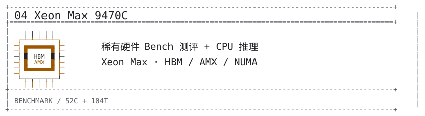
</picture>
</a>

[`[04 REPORT]`](https://2409324124.github.io/xeon-max-9470c-benchmarks/report/) · [`[SOURCE]`](https://github.com/2409324124/xeon-max-9470c-benchmarks)

<!-- NC artwork: https://github.com/Nano-Collective/nanocoder/blob/main/assets/nanocoder-icon.png -->
<a href="https://github.com/Nano-Collective/nanocoder">
<picture>
  <source media="(max-width: 600px)" srcset="assets/project-nano-mobile.svg" />
  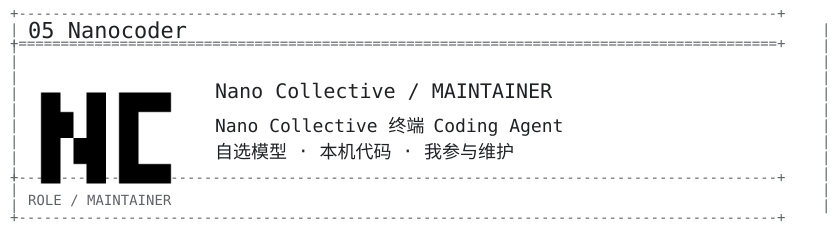
</picture>
</a>

[`[05 UPSTREAM]`](https://github.com/Nano-Collective/nanocoder) · [`[DOCS]`](https://docs.nanocollective.org/nanocoder)

<a href="https://github.com/2409324124/Qwen-Desktop-Assistant-Classic">
<picture>
  <source media="(max-width: 600px)" srcset="assets/project-latex-mobile.svg" />
  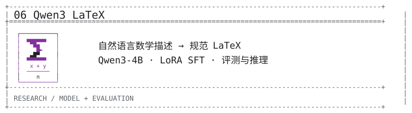
</picture>
</a>

[`[06 SOURCE]`](https://github.com/2409324124/Qwen-Desktop-Assistant-Classic) · [`[MODEL]`](https://huggingface.co/xu2409324124/qwen3-4b-latex-correction-v3-bf16)

<a href="https://github.com/felinics/Memoh">
<picture>
  <source media="(max-width: 600px)" srcset="assets/project-memoh-mobile.svg" />
  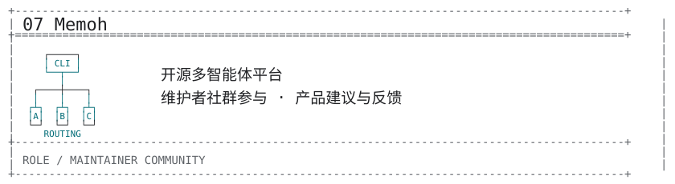
</picture>
</a>

[`[07 UPSTREAM]`](https://github.com/felinics/Memoh)

<a href="https://github.com/MilkSU-Official/milksu">
<picture>
  <source media="(max-width: 600px)" srcset="assets/project-milksu-mobile.svg" />
  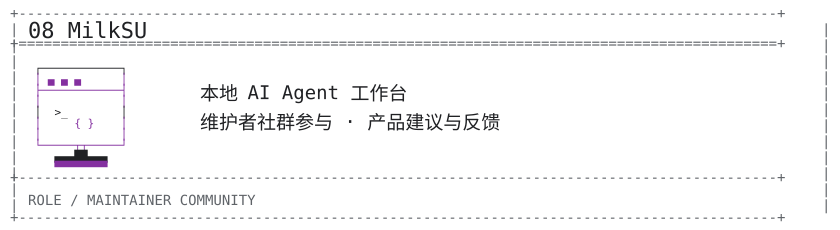
</picture>
</a>

[`[08 UPSTREAM]`](https://github.com/MilkSU-Official/milksu)

<picture>
  <source media="(max-width: 600px)" srcset="assets/section-about-mobile.svg" />
  
</picture>

<picture>
  <source media="(max-width: 600px)" srcset="assets/tech-stack-mobile.svg" />
  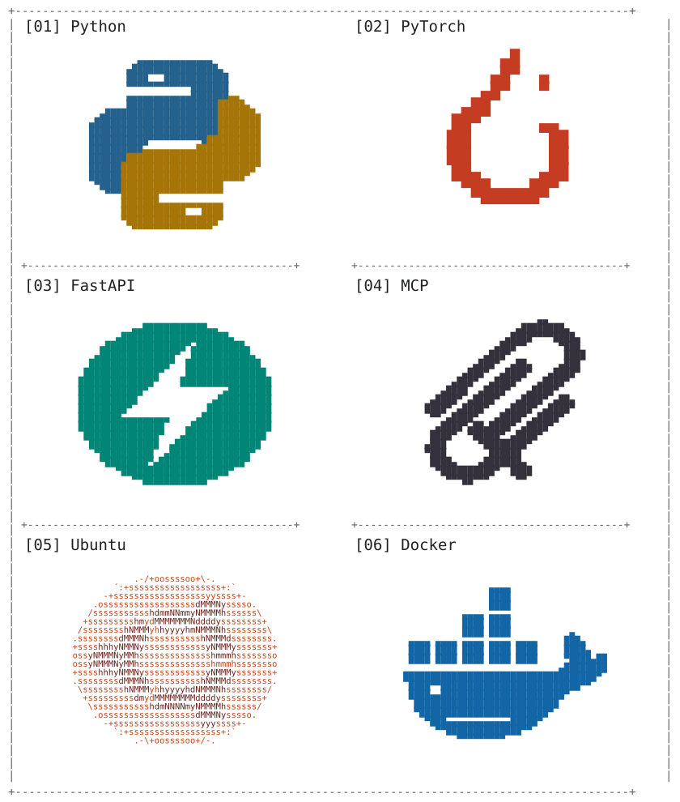
</picture>

[`[WRITING]`](https://bbs.shinonome.xyz/) · [`[RESEARCH]`](https://osf.io/preprints/socarxiv/xhky9_v1) · [`[ORCID]`](https://orcid.org/0009-0008-6625-0148)

<picture>
  <source media="(max-width: 600px)" srcset="assets/section-archive-mobile.svg" />
  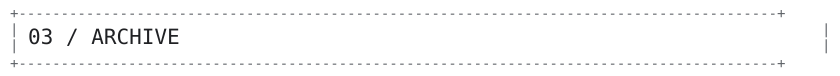
</picture>

[+] OPEN ARCHIVE / 其他项目与开源贡献

<a href="https://2409324124.github.io/programming-visualization/examples/">
<picture>
  <source media="(max-width: 600px)" srcset="assets/archive-viz-mobile.svg" />
  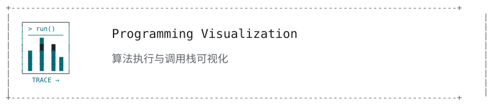
</picture>
</a>

[`[OPEN]`](https://2409324124.github.io/programming-visualization/examples/)

<a href="https://github.com/2409324124/claude-code-multi-provider-skill">
<picture>
  <source media="(max-width: 600px)" srcset="assets/archive-router-mobile.svg" />
  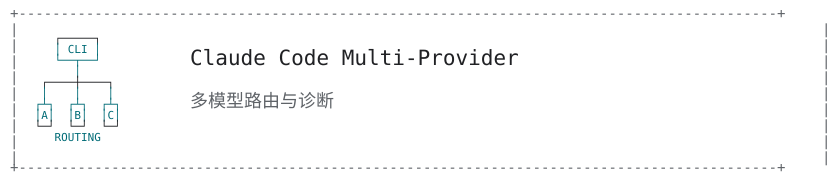
</picture>
</a>

[`[OPEN]`](https://github.com/2409324124/claude-code-multi-provider-skill)

<a href="https://github.com/2409324124/deepseek-codex-adapter">
<picture>
  <source media="(max-width: 600px)" srcset="assets/archive-deepseek-mobile.svg" />
  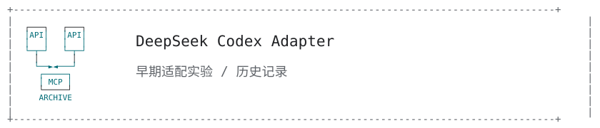
</picture>
</a>

[`[OPEN]`](https://github.com/2409324124/deepseek-codex-adapter)

<a href="https://github.com/2409324124/riichi-mahjong-recognition">
<picture>
  <source media="(max-width: 600px)" srcset="assets/archive-mahjong-mobile.svg" />
  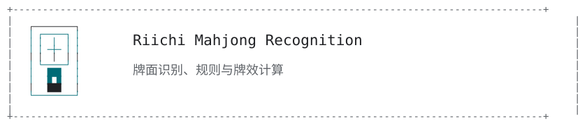
</picture>
</a>

[`[OPEN]`](https://github.com/2409324124/riichi-mahjong-recognition)

<a href="https://github.com/RVC-Boss/GPT-SoVITS/pull/2767">
<picture>
  <source media="(max-width: 600px)" srcset="assets/archive-voice-mobile.svg" />
  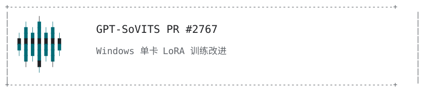
</picture>
</a>

[`[OPEN]`](https://github.com/RVC-Boss/GPT-SoVITS/pull/2767)

<a href="https://huggingface.co/spaces/xu2409324124/lstm-translator">
<picture>
  <source media="(max-width: 600px)" srcset="assets/archive-lstm-mobile.svg" />
  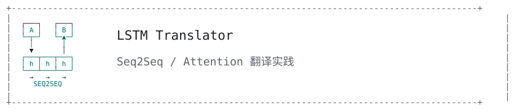
</picture>
</a>

[`[OPEN]`](https://huggingface.co/spaces/xu2409324124/lstm-translator)

Bilibili 机器学习 / 深度学习技术内容，以及 AI 教学 PPT、讲稿与 PyTorch 教学代码。

<picture>
  <source media="(max-width: 600px)" srcset="assets/section-snake-mobile.svg" />
  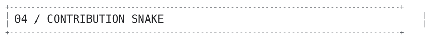
</picture>

<picture>
  <source media="(prefers-color-scheme: dark)" srcset="https://raw.githubusercontent.com/2409324124/2409324124/output/github-contribution-grid-snake-dark.svg" />
  <source media="(prefers-color-scheme: light)" srcset="https://raw.githubusercontent.com/2409324124/2409324124/output/github-contribution-grid-snake.svg" />
  
</picture>

[`[VIEW SNAKE / ORIGINAL SIZE]`](https://raw.githubusercontent.com/2409324124/2409324124/output/github-contribution-grid-snake.svg)

`+---------------- END OF TRANSMISSION ----------------+`

[`[RETURN TO HOME]`](https://shinonome.xyz/)
